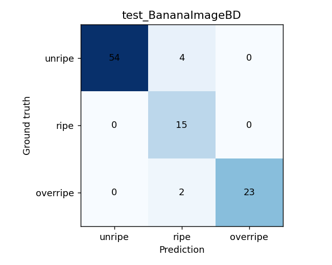
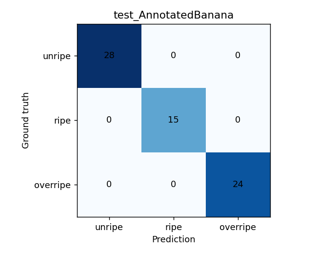
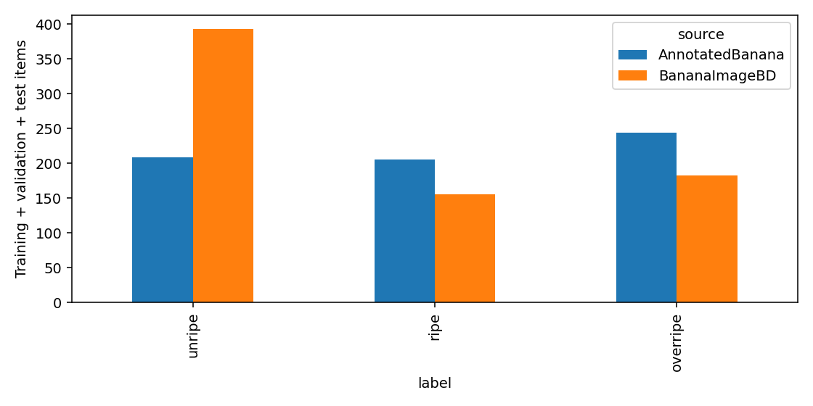
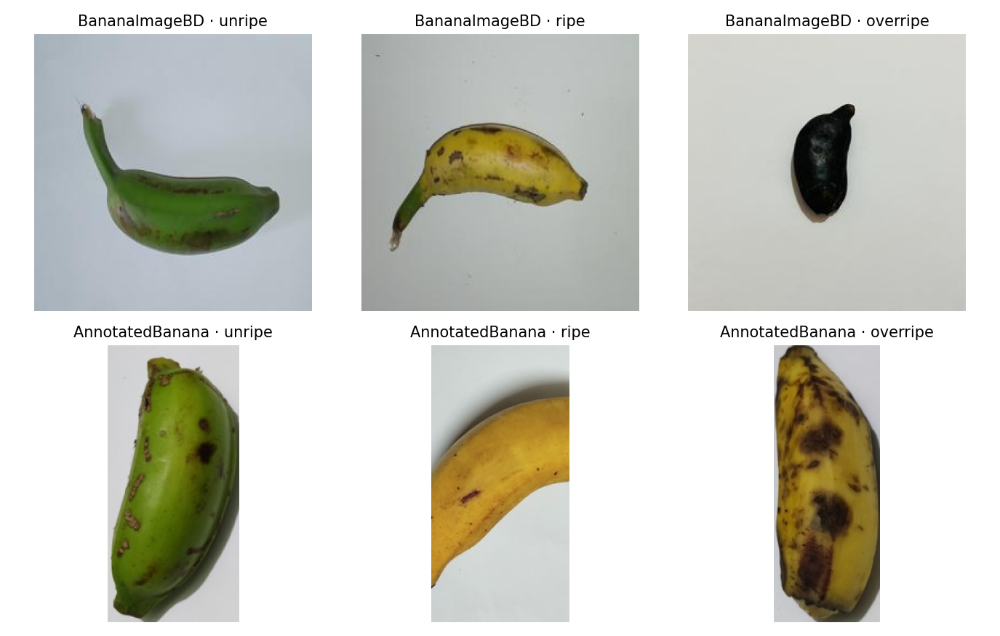
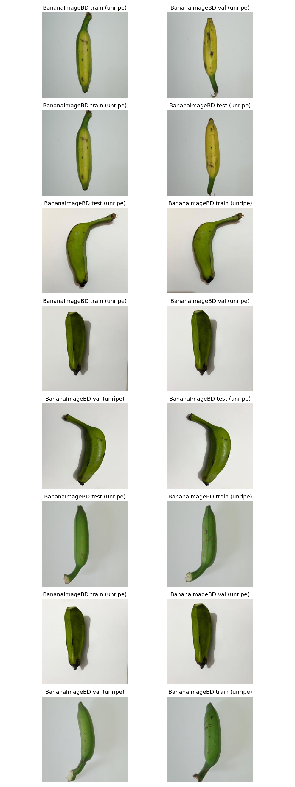
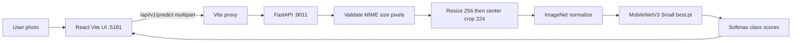
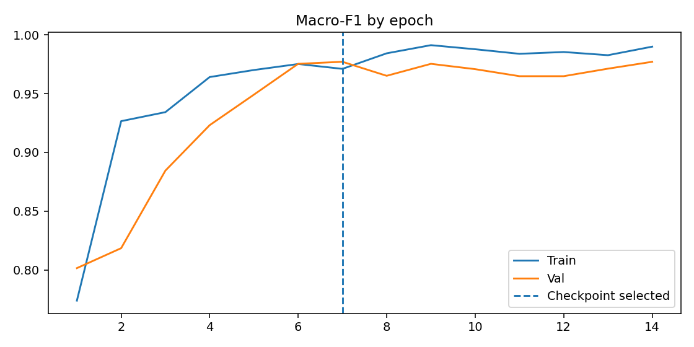
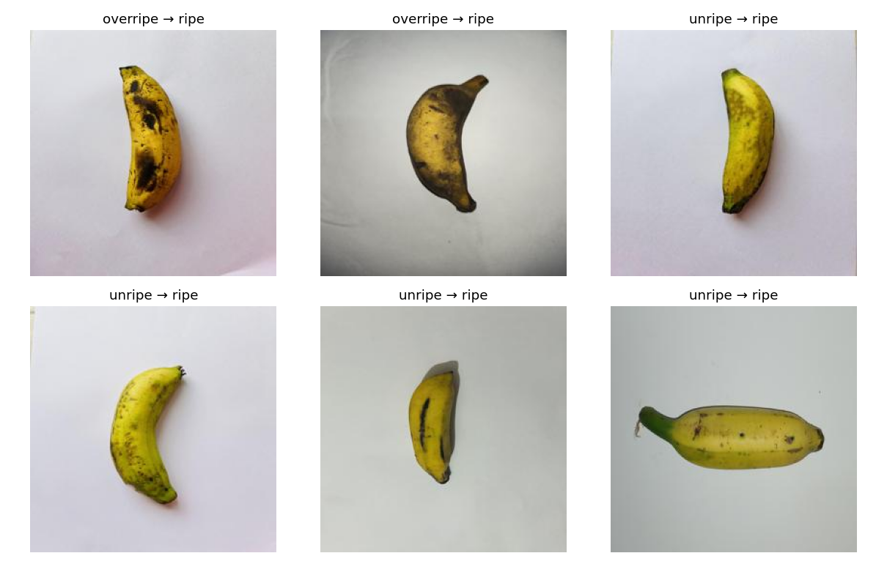

# RipenessMeter — Audited Banana Ripeness Classification

**Day 34/100 · Agriculture · Computer Vision · PyTorch · FastAPI · React**

[English documentation](docs/en/README.md) · [Dokumentasi Bahasa Indonesia](docs/id/README.md) · [API](backend/README.md) · [Research evidence](reports/README.md)


*Figure 1 — Screenshot committed to this repository. This is application evidence, **not** proof of model accuracy or production deployment.*

## Executive summary / Ringkasan eksekutif

RipenessMeter is a **locally run research prototype** for classifying an uploaded banana photograph into **unripe, ripe, or overripe**. A MobileNetV3-Small model is trained on two supervised datasets, with explicit provenance, split manifests, conflict quarantine and candidate visual-duplicate screening. A FastAPI service loads a trusted local checkpoint; a React + Vite interface uploads an image and displays per-class softmax scores. **The service does not detect multiple bananas or certify ripeness or food safety.**

RipenessMeter merupakan prototipe penelitian lokal untuk mengklasifikasikan foto pisang ke dalam tiga kelas operasional. Model dilatih pada dua dataset berlabel dengan audit konflik dan kemiripan lintas split; backend FastAPI dan frontend React menyediakan prediksi foto tunggal. Nilai *confidence* bukan probabilitas kebenaran yang telah dikalibrasi.

## Problem, users and scope

Small growers, sorters and students may need an accessible *visual* maturity screening workflow. The intended interaction is **one labeled crop or one clearly visible banana** → upload → class prediction + scores + caveat. Non-goals: multi-banana object localization, chemical maturity measurement, predicted remaining shelf-life, and commercial safety decisions. Product requirements: [PRD](docs/PRD.md).

## Current, verified implementation

| Component | Actual status | Evidence |
|---|---|---|
| Training | V3 Kaggle notebook exists and completed in supplied execution logs | [`notebooks/ripenessmeter.ipynb`](notebooks/ripenessmeter.ipynb), [`reports/run_config.json`](reports/run_config.json) |
| Data audit | 1,480 candidate samples prior to visual screening; 92 quarantined; 1,388 retained | [`dataset_audit.json`](reports/dataset_audit.json) |
| Model | MobileNetV3-Small; best **epoch 7** using validation macro-F1 | [`run_config.json`](reports/run_config.json) |
| Backend | Implemented: health, readiness, classes and image prediction APIs | [`backend/app/main.py`](backend/app/main.py) |
| Frontend | Implemented: upload/drag-drop, model status, confidence bars, reset | [`frontend/src/App.tsx`](frontend/src/App.tsx) |
| Checkpoint availability | **Not tracked on GitHub**; place a trusted `best.pt` under local `models/` | [`models/README.md`](models/README.md) |
| Deployment | Local development confirmed by user; hosted production deployment **not verified** | [Deployment](docs/en/deployment.md) |

## Held-out evaluation — V3 (not production performance)

| Source | Test examples | Accuracy | Macro-F1 | 95% bootstrap macro-F1 interval |
|---|---:|---:|---:|---|
| BananaImageBD V2 | 98 | **93.88%** | **91.87%** | 84.86–97.69% |
| AnnotatedBanana V1, object crops | 67 | **100.00%** | **100.00%** | 100–100% (dataset-conditioned) |

Source of truth: [`evaluation_by_source.json`](reports/evaluation_by_source.json) and [`bootstrap_uncertainty_by_source.json`](reports/bootstrap_uncertainty_by_source.json). **Do not interpret the 100% result as proof of real-world generalization**: it is only 67 cropped samples under the source's published partition, and subject-level independence is unverified. Testing on genuinely novel acquisition conditions remains outstanding. The test set was used for reporting, not checkpoint selection in the V3 notebook.

### BananaImageBD per-class held-out performance

| Stage | Precision | Recall | F1 | Support |
|---|---:|---:|---:|---:|
| Unripe | 1.000 | 0.931 | 0.964 | 58 |
| Ripe | 0.714 | 1.000 | **0.833** | 15 |
| Overripe | 1.000 | 0.920 | 0.958 | 25 |

**Interpretation:** The *ripe* label has weaker precision in this test, and class supports are small; do not use aggregate accuracy alone to represent quality. See [Evaluation](docs/en/evaluation.md) and [Limitations](docs/en/limitations.md).



*Figure 2 — BananaImageBD held-out confusion matrix; see numerical CSV in `reports/`.*



*Figure 3 — AnnotatedBanana cropped-object held-out test. Results may be optimistic relative to new field photography.*

## Datasets and lineage

1. **[BananaImageBD V2](https://data.mendeley.com/datasets/ptfscwtnyz/2):** 820 original images; conflicting native labels for two identical-content files → quarantine, leaving 818 prior to near-duplicate screening. Original **Green + Semi-ripe → unripe**, **Ripe → ripe**, **Overripe → overripe**. This is an operational class merge, not a statement that both physical stages are biologically identical.
2. **[Annotated Banana Ripeness Stage V1](https://data.mendeley.com/datasets/56c75hvm7r/1):** 673 annotated source images, **662 valid crops from 661 images**, **12 invalid boxes rejected**; original train/val/test assignments respected.

V3 reports **97 candidate cross-split visually similar pairs**, involving **92 quarantined samples**. It uses exact SHA-256 and a conservative 64-bit dHash + resized RGB distance heuristic. This *reduces an identified risk* but cannot certify distinct physical bananas. Source pages are listed as CC BY 4.0 **in the saved provenance report**; independently re-check current source licensing before redistributing any dataset images. The repository's MIT code license does not override source image rights.

| Source | Train | Validation | Test | After V3 screening |
|---|---:|---:|---:|---:|
| BananaImageBD | 528 | 104 | 98 | 730 |
| AnnotatedBanana crops | 527 | 64 | 67 | 658 |
| **Total** | **1,055** | **168** | **165** | **1,388** |



*Figure 4 — Distribution of eligible samples, based on V3 source manifests.*



*Figure 5 — Source samples and label categories.*



*Figure 6 — Candidate pairs for human review; computer-generated similarity flags are **not** verified identities.*

## System architecture



**Inference contract:** `JPEG/PNG/WebP`, `multipart/form-data` field **`image`**, maximum **8 MiB**, maximum **25 million pixels**, `224×224` RGB tensor normalized using ImageNet mean/std. Return JSON with `prediction`, `confidence`, `probabilities`, `uncertain`, `model`, `filename` and `disclaimer`; `uncertain` is triggered below 0.75 confidence (heuristic, **not calibrated**). [Full contract](backend/README.md).

## Local quick start — Windows PowerShell

Requirements: Python 3.11, Node.js + npm, dependencies in [`backend/requirements.txt`](backend/requirements.txt) and [`frontend/package.json`](frontend/package.json); a trusted local Kaggle V3 checkpoint at `models/best.pt`. Checkpoint is purposely excluded from Git.

```powershell
cd "D:\porto\100 day\day 34\RipenessMeter"
Set-ExecutionPolicy -Scope Process Bypass -Force
.\scripts\SETUP_RIPENESSMETER.ps1
.\scripts\START_RIPENESSMETER.ps1
```

**Current repository ports:** backend `http://127.0.0.1:8011`, frontend `http://127.0.0.1:5181` (not the old 8000/5173). Test without frontend:

```powershell
Invoke-RestMethod http://127.0.0.1:8011/api/v1/health
Invoke-RestMethod http://127.0.0.1:8011/api/v1/ready
```

API interactive specification: `http://127.0.0.1:8011/docs`. If `ready=false`, verify trusted checkpoint path, schema and server logs. The frontend proxies `/api` to `8011`; its developer server listens on `5181` with strict port selection. A backend on port 8000 belongs to another project on this machine; **do not stop unrelated processes**. [Troubleshooting](docs/en/troubleshooting.md).

## Experiment and visual evidence



*Figure 7 — V3 training-history visualization. The selected checkpoint is the highest qualifying validation macro-F1, epoch 7.*



*Figure 8 — Examples of held-out BananaImageBD errors; a useful starting point for targeted evaluation.*

Exact numeric source: [`reports/training_history.csv`](reports/training_history.csv), source-specific prediction CSV files and confusion matrices. [Experiment analysis](docs/en/experiments.md).

## Before → Now → Next

| Stage | Evidence or exit criterion |
|---|---|
| Before | Initial dual-source V2 baseline; suspected crop-similarity and label-conflict risks identified |
| Now | V3 quarantine and audit, per-source held-out evaluation, locally running FastAPI and React demo, committed visual reports |
| Next P0 | Verify real photos from new phones/sites with documented labels and parent identities; review 97 candidate pairs by hand |
| Next P1 | Calibrate scores, broaden image variety, record model SHA at deployment, integration tests through Vite proxy |
| Next P2 | Structured packaging, accessibility checks, upload-rate limits, reproducible production deployment |

## Repository map

```text
README.md · AGENTS.md · LICENSE (MIT)
notebooks/  Kaggle V3 notebook
models/     local binary checkpoint (not tracked)
reports/    JSON/CSV experiment records
assets/     plots, examples, screenshot; diagrams currently empty
backend/    FastAPI app, tests, requirements
frontend/   React/Vite/TypeScript source
scripts/    setup and start scripts
docs/       PRD, legacy references, bilingual detailed documentation
```

## Safety, privacy, limitations and license

Uploaded bytes are decoded in memory and not persistently stored by the current backend code; the service does **not** implement authentication, per-user permissions, rate limiting, audit logging or hosted privacy controls. Local-first is not equivalent to secure internet deployment. Never expose development servers publicly without additional hardening. See [security and deployment](docs/en/deployment.md). 

**License:** Code is MIT-licensed according to the existing root [`LICENSE`](LICENSE). External datasets and assets retain their own licensing and attribution. **Not a food-safety certification.**

**Author:** Wafa Bila Syaefurokhman · [GitHub](https://github.com/MENSTRUE)
