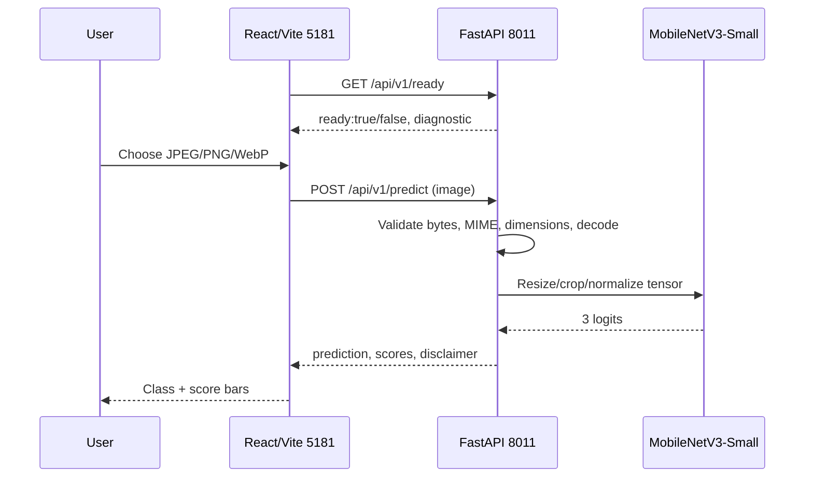

# System architecture and API data flow

## Components

**Frontend:** React 19 + TypeScript + Vite. Single page with file upload and drag/drop, 8MiB client-side guard, preview object URL, result chart, readiness indicator and manual refresh. Dev server **5181** with proxy `/api` → **8011**. **Backend:** FastAPI `backend/app/main.py`; at startup load trusted `models/best.pt`, create Torchvision MobileNetV3-Small, strict state dict and class order check. The backend never trains during request handling and has no database. [Frontend component](../../frontend/README.md) · [Backend component](../../backend/README.md).

## Input/output contract

POST multipart field `image`, max 8 MiB and 25M pixels. Runtime image pipeline: EXIF transpose → RGB → resize 256×256 → center crop 224×224 → ImageNet norm. Output schema includes `prediction`, `confidence`, `probabilities`, `uncertain`, `model`, `filename`, `disclaimer`. Error responses include 400/413/415/422/503. `GET /health` is process alive, not checkpoint proof; `GET /ready` is checkpoint readiness. API uses lock-serialized CPU/GPU model invocation; high-throughput hosting not tested.

## Architecture constraints

Vite proxy only exists in dev; for deployment configure a reverse proxy or frontend API base, host credentials separately, apply authentication/rate-limiting/HTTPS and monitoring. Backend `CORS_ORIGINS` default contains old localhost:5173 values; proxied same-origin UI works without directly exposing cross-origin backend, but direct cross-origin apps require configuration. No generated image or explanation service is implemented.
