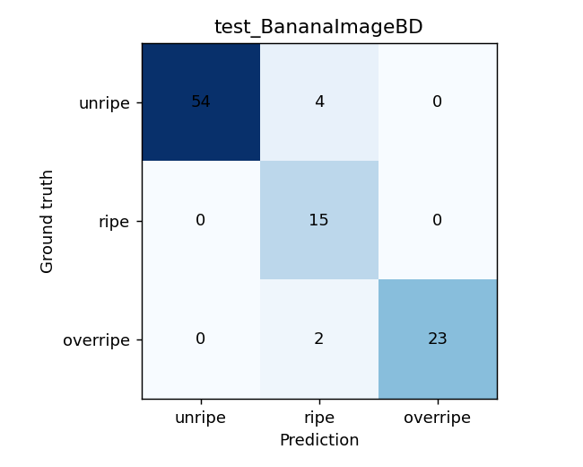
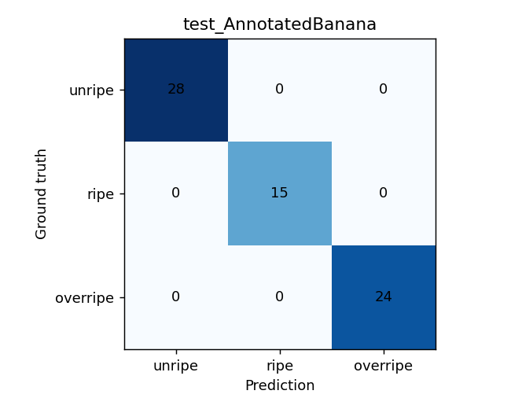

# Evaluation — source-conditioned held-out results

## Protocol

V3 selects the champion checkpoint with validation macro-F1 (best epoch 7), then reports per-source held-out test metrics without using test to pick that checkpoint. Source-native split and original-parent crop grouping are preserved. Candidate cross-split visual matches were quarantined *before training*, but this does not prove subject disjointness. `reports/evaluation_by_source.json` is canonical.

| Split/domain | n | Accuracy | Macro-F1 | Balanced accuracy |
|---|---:|---:|---:|---:|
| Val BananaImageBD | 104 | 96.15% | 96.03% | 96.03% |
| Val AnnotatedBanana | 64 | 100.00% | 100.00% | 100.00% |
| **Test BananaImageBD** | **98** | **93.88%** | **91.87%** | **95.03%** |
| **Test AnnotatedBanana** | **67** | **100.00%** | **100.00%** | **100.00%** |

Test BananaImageBD per-class F1: **unripe 0.9643** (n=58), **ripe 0.8333** (n=15), **overripe 0.9583** (n=25). Ripe precision **0.7143**, recall **1.0**: more false-positive ripe predictions relative to other classes. Inspect confusion and failure examples before selecting intervention.

*The confusion chart is a recorded result, not a real-world field benchmark.*

*Perfect source-conditioned scores do not establish subject independence or deployment reliability.*

## Uncertainty and interpretation

Parent-bootstrap (500 resamples) percentile 95% CI for test macro-F1: **BananaImageBD [0.8486, 0.9769]**, **AnnotatedBanana [1.0,1.0]**. Resampling the same limited test distribution cannot quantify external-camera shift or unseen biological subjects. Do not conflate softmax confidence with this bootstrap uncertainty.

**Reproduce figures** using committed confusion/prediction CSV files; metric JSON and the plot files are linked at [`../../reports/README.md`](../../reports/README.md).
