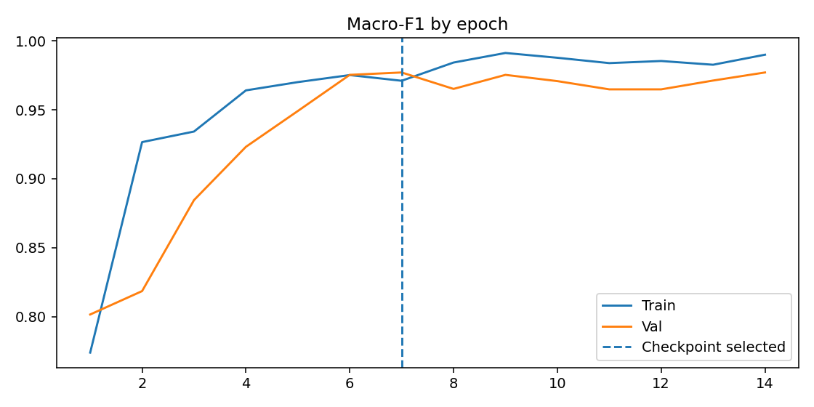

# Experiments and lineage

## Before → now

**V2** was an earlier dual-dataset supervised classifier. It was retained as a separate baseline; its test partition and audit were not identical to V3, so simple test-score differences are not a controlled algorithm comparison. **V3** adds native conflict quarantine, SHA-256 and perceptual cross-split candidate screening, per-source evaluation, and bootstrap intervals. Do not pool test scores across versions or claim V3 accuracy increased when the test composition changed.

## V3 selection and training evidence

`reports/run_config.json`: seed **42**, MobileNetV3-Small ImageNet pretrained, batch **32**, input **224**, max **35 epochs**, best **epoch 7**, best validation macro-F1 **0.977043673**. Training stopped after epoch 14 due to patience. Validation has 104 BananaImageBD and 64 AnnotatedBanana crops. Observed validation macro-F1: **0.9603** and **1.0000**, respectively. The global selection metric is not a substitute for either source report.

*V3 learning curve. Selected epoch comes from validation only.*

## Auditing changes

820 primary originals → quarantine 2 source-native conflicts; 673 secondary originals → 662 valid crops, 12 rejected bounding-box rows. 1,480 eligible samples before cross-split visual screening → quarantine **92** samples from **97** flagged pairs → **1,388** samples, split train/val/test = **1,055/168/165**. This quarantine was automated; its false-positive and false-negative rate is not established. Review the candidate gallery and sample log before claiming disjoint banana identities.

## Artifacts

[`training_history.csv`](../../reports/training_history.csv), [`run_config.json`](../../reports/run_config.json), [`dataset_audit.json`](../../reports/dataset_audit.json), [`test_..._predictions.csv`](../../reports/test_BananaImageBD_predictions.csv), source confusion matrices and plotted failures. **Not verified:** independent field benchmark, probabilistic calibration, exact local hash match of binary checkpoint stored outside GitHub.
