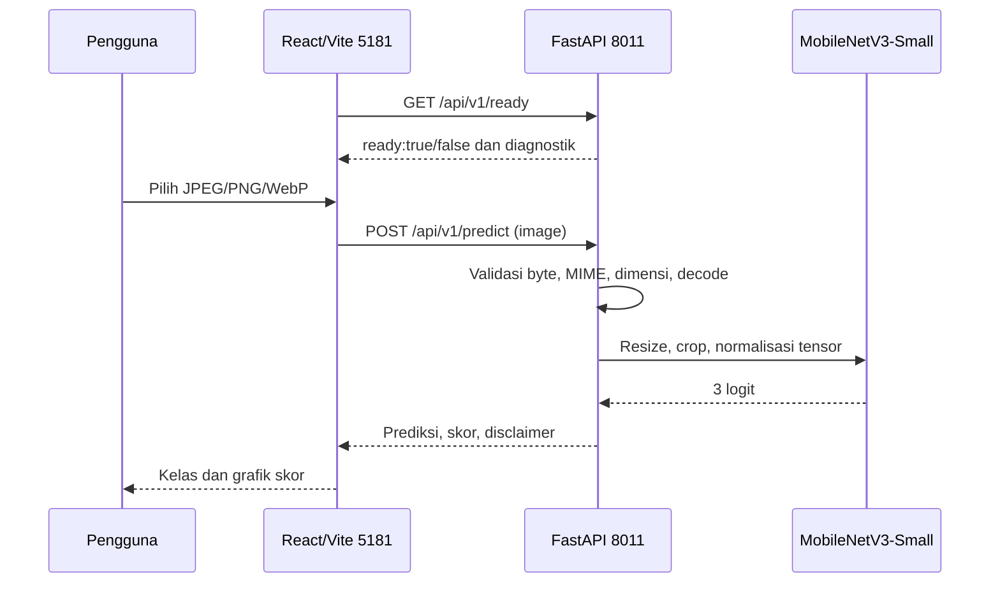

# Arsitektur sistem dan aliran API

## Komponen

**Frontend:** React 19 + TypeScript + Vite. Satu halaman dengan upload/drag-drop, validasi client maksimum 8 MiB, preview object URL, grafik skor, indikator readiness dan refresh manual. Dev server **5181**, proxy `/api` → **8011**. **Backend:** FastAPI `backend/app/main.py`; saat startup memuat `models/best.pt` terpercaya, membuat MobileNetV3-Small Torchvision, memvalidasi state dict dan urutan kelas secara ketat. Backend tidak melatih model saat request dan tidak memakai database. [Komponen frontend](../../frontend/README.md) · [Komponen backend](../../backend/README.md).

## Kontrak masukan/keluaran

POST multipart field `image`, maksimum 8 MiB dan 25 juta piksel. Pipeline runtime: koreksi EXIF → RGB → resize 256×256 → center crop 224×224 → normalisasi ImageNet. Respons berisi `prediction`, `confidence`, `probabilities`, `uncertain`, `model`, `filename`, `disclaimer`. Error meliputi 400/413/415/422/503. `GET /health` menandakan proses hidup, bukan bukti model; `GET /ready` readiness checkpoint. API memakai lock pada panggilan model; throughput produksi belum diuji.

## Batas arsitektur

Proxy Vite hanya berlaku di development; deployment memerlukan reverse proxy atau API base URL, secrets terpisah, autentikasi/rate limiting/HTTPS, dan monitoring. Default `CORS_ORIGINS` backend masih memuat localhost:5173 lama; UI same-origin melalui proxy bekerja, tetapi akses cross-origin langsung harus dikonfigurasi. Tidak ada layanan generasi gambar atau narasi AI tambahan.
