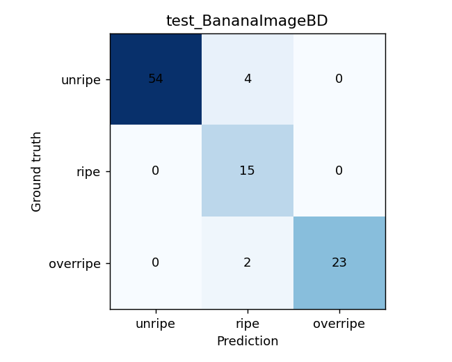
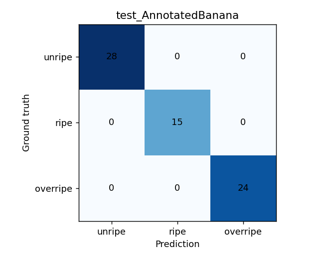

# Evaluasi — hasil held-out per sumber

## Protokol

V3 memilih champion berdasarkan macro-F1 validasi (epoch terbaik 7), kemudian melaporkan test held-out per sumber tanpa memakai test untuk pemilihan checkpoint. Split asli tiap sumber dan pengelompokan crop pada gambar induk dipertahankan. Kandidat kemiripan visual lintas split dikarantina *sebelum training*, tetapi identitas buah independen belum terjamin. Acuan numerik utama: `reports/evaluation_by_source.json`.

| Split/sumber | n | Accuracy | Macro-F1 | Balanced accuracy |
|---|---:|---:|---:|---:|
| Val BananaImageBD | 104 | 96,15% | 96,03% | 96,03% |
| Val AnnotatedBanana | 64 | 100,00% | 100,00% | 100,00% |
| **Test BananaImageBD** | **98** | **93,88%** | **91,87%** | **95,03%** |
| **Test AnnotatedBanana** | **67** | **100,00%** | **100,00%** | **100,00%** |

F1 per kelas test BananaImageBD: **unripe 0,9643** (n=58), **ripe 0,8333** (n=15), **overripe 0,9583** (n=25). Precision ripe **0,7143**, recall **1,0**: false positive terhadap kelas ripe relatif lebih tinggi. Tinjau confusion dan contoh kegagalan sebelum memilih perbaikan.

*Confusion matrix ini hasil eksperimen sumber, bukan benchmark lapangan.*

*Skor sempurna pada sumber ini tidak membuktikan independensi buah atau keandalan deployment.*

## Ketidakpastian dan interpretasi

Interval persentil bootstrap gambar induk (500 resampling) 95% untuk macro-F1 test: **BananaImageBD [0,8486, 0,9769]**, **AnnotatedBanana [1,0,1,0]**. Resampling distribusi test kecil yang sama tidak mengukur pergeseran ke kamera luar atau identitas buah baru. Nilai confidence softmax bukan interval bootstrap tersebut.

**Reproduksi gambar** dari CSV prediksi/confusion yang sudah di-commit; referensi metrik dan plot berada di [`../../reports/README.md`](../../reports/README.md).
