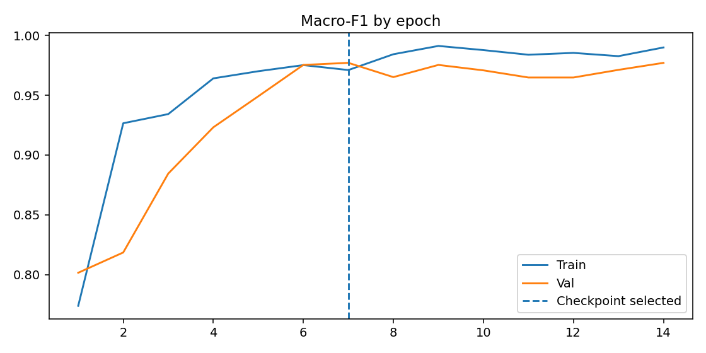

# Eksperimen dan jejak versi

## Sebelum → sekarang

**V2** merupakan baseline klasifikasi terawasi dua dataset yang lebih awal. V2 dipertahankan sebagai eksperimen terpisah; partisi test dan auditnya tidak identik dengan V3 sehingga beda skor mentah bukan perbandingan algoritme terkontrol. **V3** menambah karantina konflik label asli, penyaringan duplikat SHA-256/perseptual lintas split, evaluasi per sumber, serta interval bootstrap. Jangan menggabungkan skor test lintas versi atau mengklaim akurasi V3 meningkat pada komposisi test yang berbeda.

## Seleksi champion dan bukti training V3

`reports/run_config.json`: seed **42**, MobileNetV3-Small pretrained ImageNet, batch **32**, input **224**, maksimum **35 epoch**, terbaik **epoch 7**, macro-F1 validasi terbaik **0,977043673**. Training berhenti setelah epoch 14 karena patience. Validasi berisi 104 sampel BananaImageBD dan 64 crop AnnotatedBanana. Macro-F1 validasi teramati masing-masing **0,9603** dan **1,0000**. Skor pemilihan global tidak menggantikan laporan per sumber.

*Kurva pelatihan V3. Pemilihan epoch hanya berdasarkan validasi.*

## Perubahan audit

820 gambar utama → karantina 2 konflik label asli; 673 gambar sekunder → 662 crop valid dan 12 anotasi kotak ditolak. 1.480 sampel sebelum screening visual lintas split → **92** sampel dikarantina dari **97** pasangan yang ditandai → **1.388** sampel, split train/val/test **1.055/168/165**. Karantina berjalan otomatis; tingkat false positive/negative belum diukur. Tinjau galeri kandidat sebelum menyatakan semua identitas buah independen.

## Artefak

[`training_history.csv`](../../reports/training_history.csv), [`run_config.json`](../../reports/run_config.json), [`dataset_audit.json`](../../reports/dataset_audit.json), [`test_..._predictions.csv`](../../reports/test_BananaImageBD_predictions.csv), confusion matrix dan contoh kesalahan. **Belum diverifikasi:** benchmark lapangan independen, kalibrasi probabilitas, kesesuaian hash checkpoint lokal yang tidak disimpan di GitHub.
